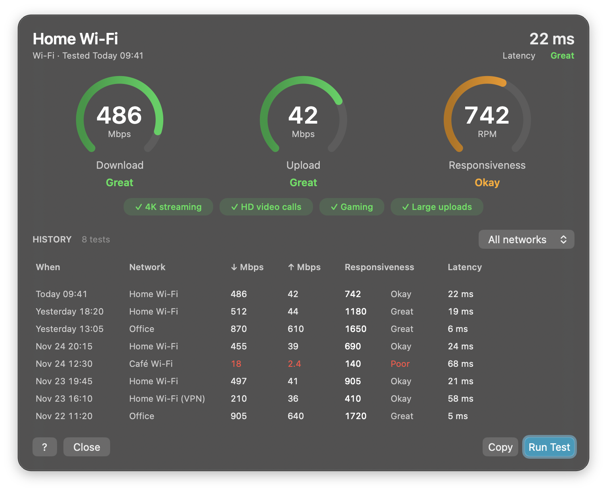
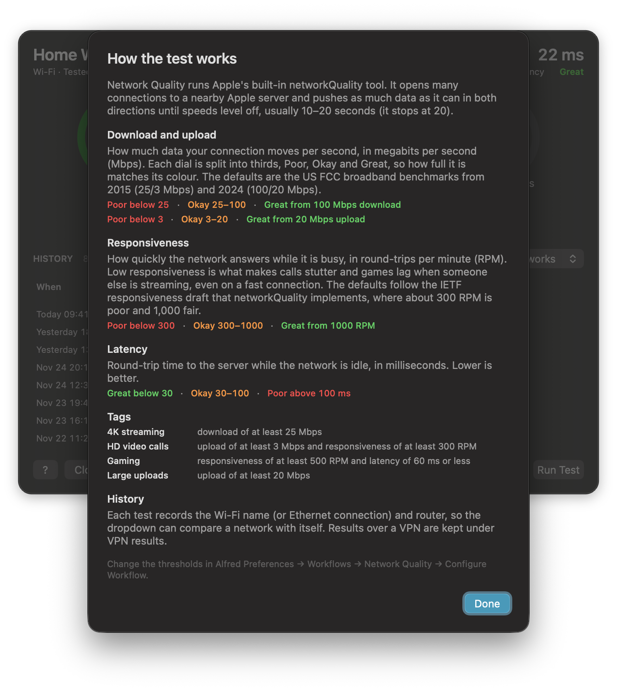
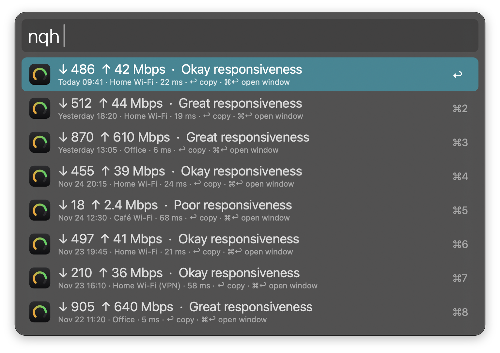

#  Network Quality

Test your connection with macOS's built-in `networkQuality`. Watch the results come in live, see at a glance whether they're good enough for calls, streaming and gaming, and compare each network with itself over time.

[⤓ Download the latest release](https://github.com/OmerAvital/alfred-network-quality/releases/latest)

Requires Alfred 6 with the Powerpack, on a Mac that has `networkQuality` (macOS Monterey or later).

## Usage

Open the window with the `nq` keyword. Press <kbd>↩</kbd> to run a test.

- <kbd>↩</kbd> runs a test, or stops one that's running.
- <kbd>⌘</kbd><kbd>C</kbd> copies the result.
- <kbd>⌘</kbd><kbd>/</kbd> or the **?** button explains each number and the current thresholds.
- The dropdown filters the history by network. Results over a VPN are kept separate.
- Close the window mid-test and the test still finishes. You get a notification with the result.

Each result is graded **Poor**, **Okay** or **Great**, and the tags show what the connection is good enough for.

Browse past results right in Alfred with the `nqh` keyword. Type a network name to filter.

- <kbd>↩</kbd> copies a result.
- <kbd>⌘</kbd><kbd>↩</kbd> opens the window.

## Configuration

In Alfred → Workflows → Network Quality → **Configure Workflow**:

- **Keywords** for the window and the history.
- **Auto-start** runs a test as soon as the window opens.
- **Test mode**: parallel (default), sequential, download only or upload only.
- **Grade thresholds** for each measure, as sliders. Download and upload default to the FCC's 2015 and 2024 broadband benchmarks. Responsiveness defaults to the bands in the IETF responsiveness draft that `networkQuality` implements.
